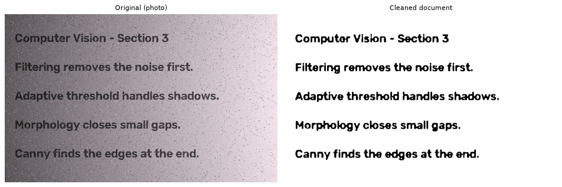
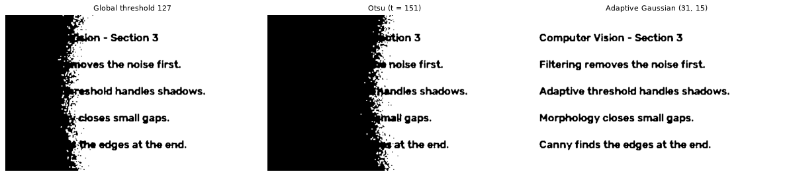
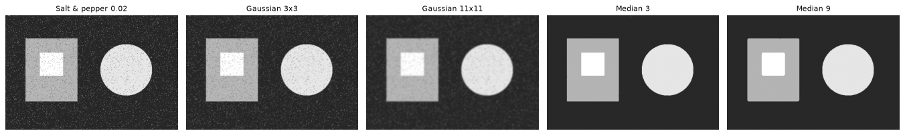
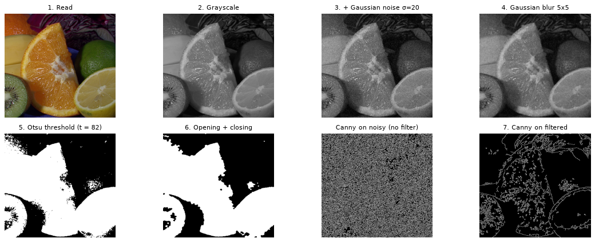

# CV Section 3 — Filtering, Thresholding & Edges

Solutions for the Section 3 practice tasks and the final challenge.

| File | |
|---|---|
| `CV_Section3_Solutions.ipynb` | my solutions only |
| `CV_Section3_Tasks_Amr.ipynb` | the full section notebook with my solutions at the end |
| `Computer_Vision_section_3.ipynb` | the original section notebook |

## Tasks

- [x] **Noise**: σ 25 → 50 and salt & pepper 0.02 → 0.08. The 0.08 salt & pepper is the hardest to recognize.
- [x] **Filtering**: Gaussian 3 / 11 and median 3 / 9. Median keeps the boundaries sharp.
- [x] **Thresholding**: 60 / 120 / 200 vs Otsu. A manual threshold fails under uneven lighting.
- [x] **Morphology**: kernels 3 / 7 / 11. A kernel that is too big merges or eats the objects.
- [x] **Canny**: (30,100) / (50,150) / (100,200) on a clean and a noisy image.
- [x] **Own pipeline**: read → gray → noise → filter → threshold → morphology → Canny.
- [x] **Final challenge**: document cleanup with adaptive threshold, compared with global and Otsu.

---

Amr Ahmed Elgharip
